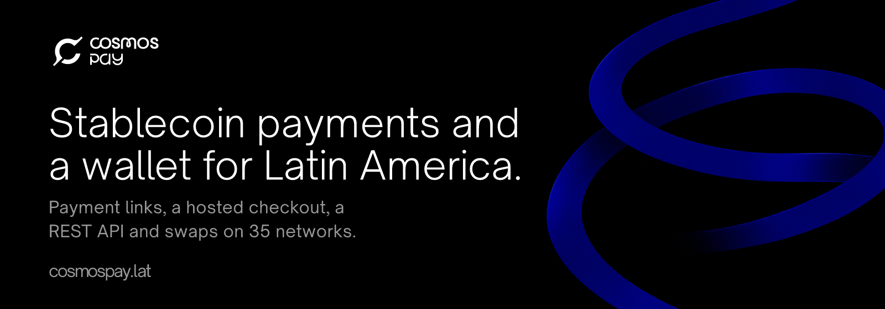
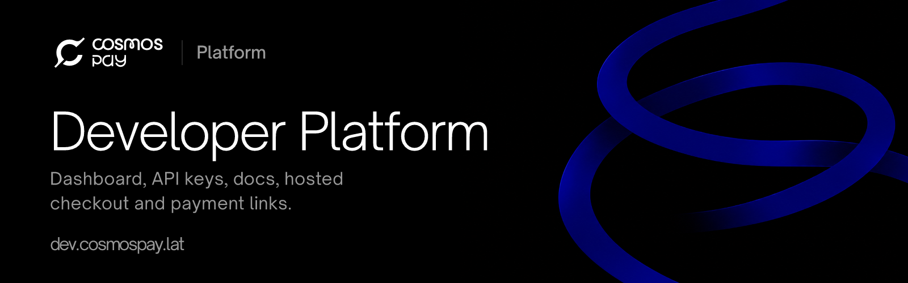
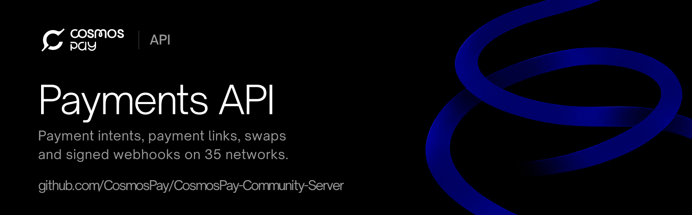
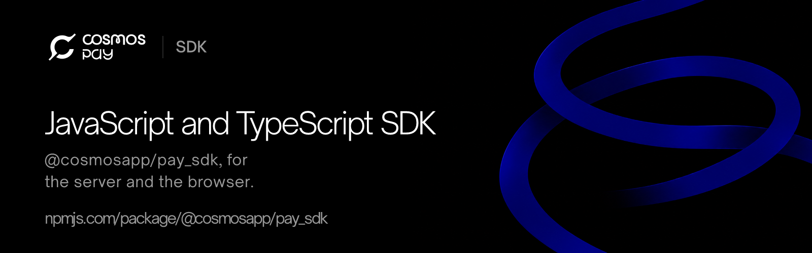
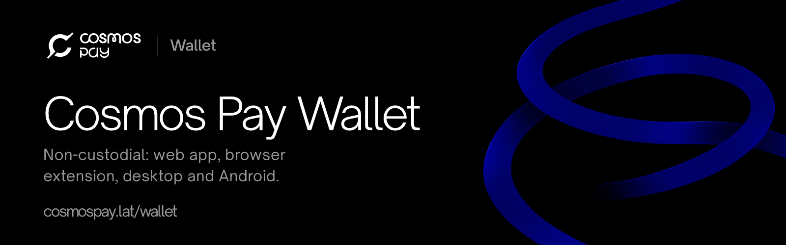
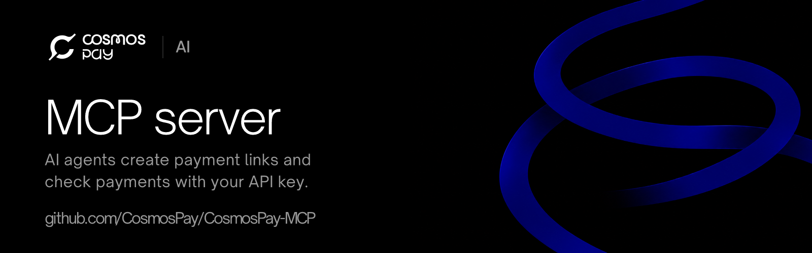
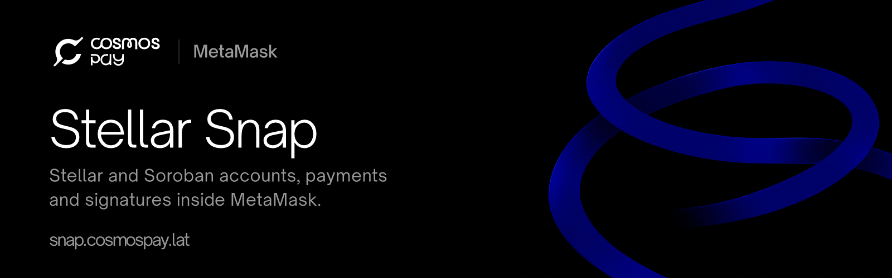
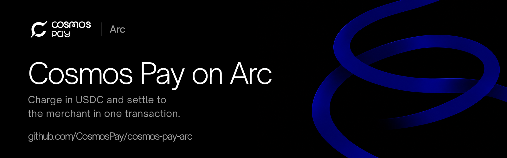
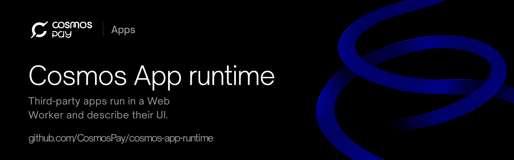
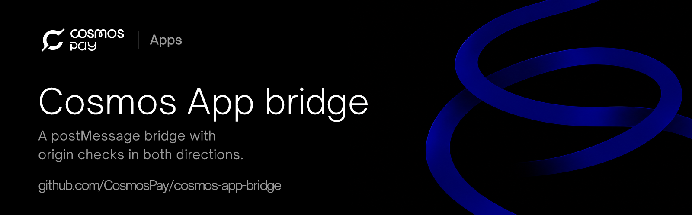

<p align="center">
  <a href="https://cosmospay.lat"></a>
</p>

# Cosmos Pay

Cosmos Pay is a stablecoin payments platform for businesses in Latin America. Merchants accept USDC and other stablecoins on 35 networks through payment links, a hosted checkout or a REST API, and the money reaches an address they control. Cosmos Pay also offers swaps between those networks and a non-custodial wallet.

[Website](https://cosmospay.lat) · [Payment gateway](https://payments.cosmospay.lat) · [Docs](https://dev.cosmospay.lat/docs/) · [Pricing](https://cosmospay.lat/pricing) · [JS/TS SDK on npm](https://www.npmjs.com/package/@cosmosapp/pay_sdk) · [organization@cosmospay.lat](mailto:organization@cosmospay.lat)

<sub>Cosmos Pay (cosmospay.lat) is a different project from the Cosmos Network (ATOM) and from BitCanna's CosmosPay plugins.</sub>

## Products

<table>
  <tr>
    <td width="50%" valign="top">
      <a href="https://github.com/CosmosPay/CosmosPay-Developer-Platform"></a>
      <br><b><a href="https://github.com/CosmosPay/CosmosPay-Developer-Platform">Developer Platform</a></b>
      <br>The dashboard, API keys, docs, hosted checkout and payment links behind cosmospay.lat, payments.cosmospay.lat and dev.cosmospay.lat.
    </td>
    <td width="50%" valign="top">
      <a href="https://github.com/CosmosPay/CosmosPay-Community-Server"></a>
      <br><b><a href="https://github.com/CosmosPay/CosmosPay-Community-Server">Payments API</a></b>
      <br>NestJS and Prisma: payment intents, payment links, swaps and signed webhooks on 35 networks.
    </td>
  </tr>
  <tr>
    <td width="50%" valign="top">
      <a href="https://github.com/CosmosPay/CosmosJS_SDK"></a>
      <br><b><a href="https://github.com/CosmosPay/CosmosJS_SDK">JavaScript and TypeScript SDK</a></b>
      <br><code>@cosmosapp/pay_sdk</code>, the typed client of the Payments API for the server and the browser.
    </td>
    <td width="50%" valign="top">
      <a href="https://github.com/CosmosPay/CosmosPay-Wallet"></a>
      <br><b><a href="https://github.com/CosmosPay/CosmosPay-Wallet">Cosmos Pay Wallet</a></b>
      <br>Non-custodial wallet: web app, browser extension, desktop and Android. Keys are generated and encrypted on the device.
    </td>
  </tr>
</table>

## For AI agents

<table>
  <tr>
    <td width="50%" valign="top">
      <a href="https://github.com/CosmosPay/CosmosPay-MCP"></a>
      <br><b><a href="https://github.com/CosmosPay/CosmosPay-MCP">MCP server</a></b>
      <br>AI agents create stablecoin payment links and check payments with your API key.
    </td>
    <td width="50%" valign="top">
      <a href="https://github.com/CosmosPay/CosmosPay-Skill"></a>
      <br><b><a href="https://github.com/CosmosPay/CosmosPay-Skill">Agent skill</a></b>
      <br>A <code>SKILL.md</code> that teaches AI coding agents to integrate Cosmos Pay: payment intents, links, checkout, webhooks and swaps.
    </td>
  </tr>
</table>

- [Docs index for LLMs](https://dev.cosmospay.lat/docs/llms.txt) and the [site summary](https://cosmospay.lat/llms.txt). Every indexable page is also Markdown at its address with `.md`.
- [How an agent authenticates](https://cosmospay.lat/auth.md): an API key a person creates in the dashboard.
- The skill is listed in the [agent skills index](https://cosmospay.lat/.well-known/agent-skills/index.json). See [using the docs with AI](https://dev.cosmospay.lat/docs/ai/).

## Open source building blocks

<table>
  <tr>
    <td width="50%" valign="top">
      <a href="https://github.com/CosmosPay/Stellar-Snap"></a>
      <br><b><a href="https://github.com/CosmosPay/Stellar-Snap">Stellar Snap</a></b>
      <br>MetaMask Snap for Stellar and Soroban accounts, payments, swaps and signatures, with a SEP-43 adapter for dApps.
    </td>
    <td width="50%" valign="top">
      <a href="https://github.com/CosmosPay/cosmos-pay-arc"></a>
      <br><b><a href="https://github.com/CosmosPay/cosmos-pay-arc">Cosmos Pay on Arc</a></b>
      <br>A payment intent on Arc, the USDC-gas L1: charge in USDC and settle to the merchant in one transaction.
    </td>
  </tr>
  <tr>
    <td width="50%" valign="top">
      <a href="https://github.com/CosmosPay/cosmos-app-runtime"></a>
      <br><b><a href="https://github.com/CosmosPay/cosmos-app-runtime">Cosmos App runtime</a></b>
      <br>Declarative runtime for third-party Cosmos Apps: the app runs in a Web Worker and describes its UI.
    </td>
    <td width="50%" valign="top">
      <a href="https://github.com/CosmosPay/cosmos-app-bridge"></a>
      <br><b><a href="https://github.com/CosmosPay/cosmos-app-bridge">Cosmos App bridge</a></b>
      <br>postMessage bridge between a Cosmos App and the platform that embeds it, with origin checks in both directions.
    </td>
  </tr>
</table>

## What it does

- **Payment links and QR codes** from the dashboard, with no code.
- **Hosted and embedded checkout** in seven languages. A pay button or an embedded checkout takes one script tag.
- **Payments REST API** described by an [OpenAPI document](https://dev.cosmospay.lat/docs/openapi.json), a typed JavaScript and TypeScript SDK and webhooks signed with HMAC-SHA256.
- **35 networks**: customers pay from the network they already use, with swaps between all of them.
- **Non-custodial**: every payment settles to the merchant's own address.
- **Test first**: `dv_` API keys run on test networks and `prod_` keys on mainnet. The key picks the network.
- **Pricing per payment**, from 1.5% + 18¢ on Starter with no monthly fee. See the [plans](https://cosmospay.lat/pricing).

## Get started

```bash
npm install @cosmosapp/pay_sdk
```

Create an account and your API keys in the [Developer Platform](https://dev.cosmospay.lat), then follow the [server SDK quickstart](https://dev.cosmospay.lat/docs/sdk/server/quickstart/).

---

<p align="center"><sub>Cosmos Pay is built in Argentina. <a href="https://cosmospay.lat">cosmospay.lat</a> · <a href="https://x.com/CosmosPay">X</a> · <a href="https://www.linkedin.com/company/cosmospay/">LinkedIn</a> · <a href="https://www.instagram.com/cosmospay.lat/">Instagram</a> · <a href="https://discord.gg/Yb5MNcqQsp">Discord</a></sub></p>
